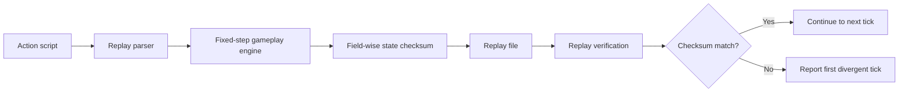

# ReplayForge: engineering design notes

## Problem

Reproducing a gameplay bug requires the same initial state and input sequence to lead to the same resulting state. ReplayForge provides a deliberately small deterministic simulation and a line-oriented replay file that identifies the first tick where actual state diverges from a stored baseline.

## Architecture

`step` modifies only its explicitly supplied `State` and `Input`; it uses no timestamps, random values, file system state, or global mutable variables. The replay parser accepts a versioned text format with strict action codes and monotonically increasing tick numbers.

## Tick semantics

1. Both players apply at most one movement or attack action per tick.
2. Movements resolve against the grid bounds; defeated players cannot act.
3. Attacks from surviving players are evaluated based on resulting positions; both attack flags are computed *before* damage is applied, so simultaneous damage is possible.
4. An attack deals 10 health damage to an opponent within Manhattan distance 1. Health cannot become negative.
5. Increment the tick, then hash its state in a defined order.

## State fingerprint

FNV-1a 64-bit mixes the tick index followed by each player's X, Y, and HP as four little-endian bytes per 32-bit integer. This avoids hashing native struct layout or padding. It is a **debugging fingerprint**, not tamper-proof signing, encryption, or player security infrastructure.

## Tradeoffs and limitations

- Integer coordinates and combat make the simulation deterministic but are not a general-purpose physics engine.
- Positions can overlap or cross. Collision resolution is outside this prototype's scope.
- Checksums detect divergence but do not identify the underlying bug or prevent malicious recomputation of a trace.
- No rollback, networking, state snapshots, RNG streams, animation, or real players are included.
- The source-input file and output replay file must differ. Recording refuses existing destinations and pre-existing staging files, writes to a sibling temporary path, checks closure, and renames after success. This prevents routine accidental overwrites and many partial-file failures, but does not guarantee durable storage after power loss or safe behavior under concurrent writers. Use a new filename to record again.
- The written replay format is versioned so changes to rules should also update fixtures and format compatibility documentation.

## Verification checklist

- Configure and compile in a fresh build directory.
- Run 13 C++ unit tests, the eight CLI integration tests, and all three CTest entries.
- Verify the committed eight-tick golden trace; change one checksum in a copy and verify failure at the expected tick.
- Build with at least one additional compiler and compare golden output.
- Run the source encoding check.
- Publish a feature branch and use actual GitHub Actions results for cross-platform claims.

A future enhancement could simulate a delayed command queue with a seeded, synthetic network schedule and measure state reconciliation; keep that as a separate, focused milestone.
